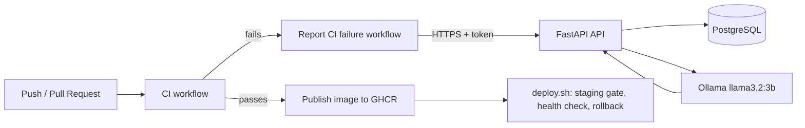

# CI/CD Failure Analyzer

When a GitHub Actions run fails, this service receives the failed job's logs, asks a local LLM for the root cause and a fix, stores the result in PostgreSQL, and exposes it through a token-protected API.

## Architecture



## CI/CD pipeline

| Stage | What it does |
|-------|--------------|
| Lint | `ruff` on every push and pull request |
| Tests | `pytest` (auth, storage, error paths) with a fake LLM |
| Dependency scan | `pip-audit` on `requirements.txt` |
| Build check | Docker image builds before anything is published |
| Caching | pip dependency cache in GitHub Actions |
| Artifact | Image pushed to GHCR, tagged with the commit SHA (immutable) and `latest` |
| Gate | Publishing only runs on `main`, and only after every earlier job passes |
| Staging | `scripts/deploy.sh` starts the new image on a staging port and checks `/health` first |
| Health check | Production is verified with `/health` after the swap |
| Rollback | If production is unhealthy, the previous image is restored automatically |
| HTTPS | Public access goes through a Cloudflare quick tunnel (HTTPS) |

## API

| Method | Path | Auth | Purpose |
|--------|------|------|---------|
| GET | `/health` | none | Liveness check |
| POST | `/webhook/failure` | token | Receive failed-run logs, analyze, store |
| GET | `/failures` | token | List stored failures |
| GET | `/failures/{id}` | token | Full log and analysis for one failure |

Token-protected routes expect an `X-Webhook-Token` header.

## Run locally

Requirements: Docker with Docker Compose.

```bash
echo "WEBHOOK_TOKEN=$(openssl rand -hex 24)" > .env
docker compose up -d --build
docker compose exec ollama ollama pull llama3.2:3b
curl localhost:8000/health
```

## Run the checks

```bash
docker run --rm -v "$PWD":/code -w /code python:3.12-slim sh -c "pip install -q -r requirements.txt -r requirements-dev.txt && ruff check . && python -m pytest -q"
```

## Deploy a published image

```bash
scripts/deploy.sh <commit-sha>
```

The script deploys one exact commit SHA, so every release is traceable.

## Stack

FastAPI, PostgreSQL, SQLAlchemy, Docker Compose, Ollama (llama3.2:3b), GitHub Actions, GitHub Container Registry, Cloudflare quick tunnel.